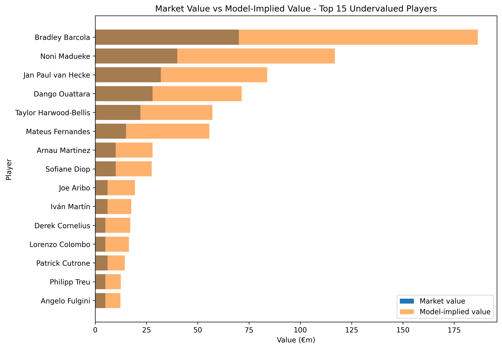
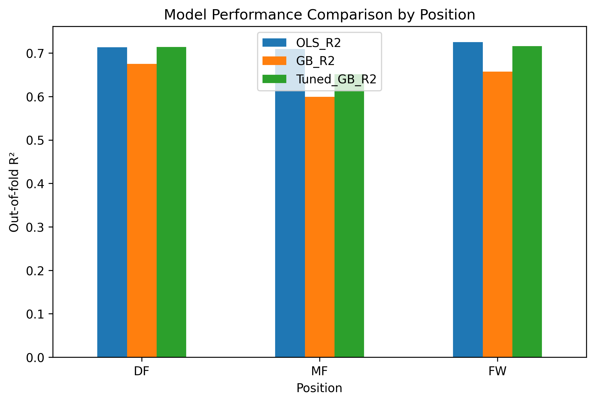
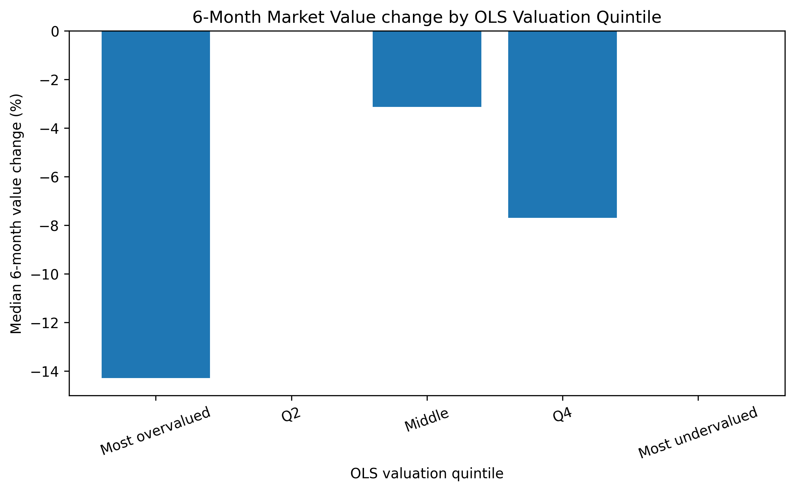
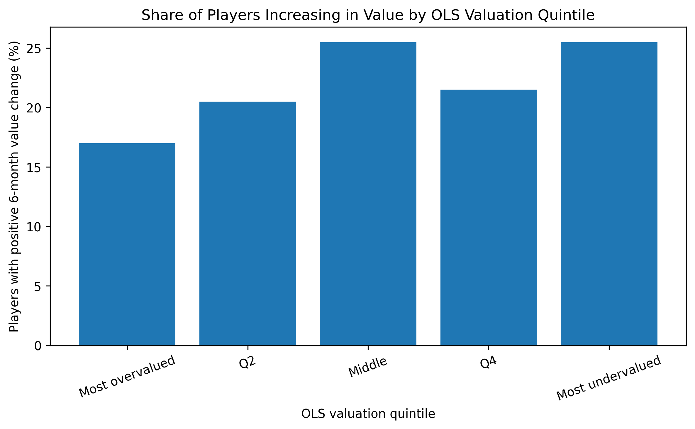

# Undervalued Football Players
## Summary

This project builds position-specific football player valuation models using FBref and Transfermarkt data to identify potentially undervalued players.

Key results:
- OLS models achieved approximately 0.71–0.73 out-of-fold R² across position groups
- Valuation gaps showed a statistically significant relationship with subsequent 6-month market value changes
- The strongest signal appeared when comparing the most undervalued and most overvalued player groups
- Final outputs include scouting shortlists by position and model-implied vs observed valuations

## Tech Stack

Python · pandas · NumPy · scikit-learn · statsmodels · SciPy · RapidFuzz

## Project Overview

This project investigates whether publicly available football performance data can be used to identify players whose market valuation appears low relative to their statistical profile.

The analysis combines FBref performance statistics with Transfermarkt market valuations to build position-specific player valuation models. The resulting model-implied values are compared with observed market values to calculate a valuation gap and rank potentially undervalued and overvalued players.

The project also evaluates whether these valuation gaps contain predictive information by backtesting them against subsequent market value changes.

## Research Question

Can publicly available football performance data identify players whose market valuation appears low relative to their statistical profile, and does this valuation gap predict subsequent market-value appreciation?

## Data

The project combines:

- FBref player performance data for the 2024/25 season
- Transfermarkt player information
- Transfermarkt historical market valuations

The final modelling dataset contains outfield players across defenders, midfielders and forwards.

Goalkeepers are excluded because their performance profiles require a different modelling framework.

## Data Preparation

The data preparation pipeline includes:

- Player entity matching across FBref and Transfermarkt
- Name normalization and fuzzy matching
- Birth-year matching
- Manual corrections for unresolved player matches
- Selection of the latest available market valuation near the end of the 2024/25 season
- Position classification into defenders, midfielders and forwards
- Minimum playing-time filtering
- Conversion of counting statistics to per-90 metrics

## Feature Engineering

Separate feature sets are used for:

- Defenders
- Midfielders
- Forwards

The models include football performance variables together with controls for:

- Age
- Non-linear age effects
- Playing time
- Competition

Position-specific features were selected using football-domain reasoning and model diagnostics.

An automated Sequential Feature Selection experiment was also conducted as a robustness check. The automatically selected defender feature set produced weaker out-of-fold performance than the manually curated specification, so it was not retained in the final model.

## Modelling Approach

Market value is modelled on the logarithmic scale:

`log(market value)`

Separate models are estimated for each position group.

The main model is Ordinary Least Squares regression.

Gradient Boosting models are also trained as a benchmark, including a tuned version using Grid Search.

Model performance is evaluated using 5-fold cross-validation and out-of-fold predictions.

### Model Performance

| Position | OLS R² | OLS MAE (€m) | Gradient Boosting R² | Tuned GB R² |
|---|---:|---:|---:|---:|
| Defenders | 0.713 | 6.05 | 0.675 | 0.714 |
| Midfielders | 0.709 | 8.42 | 0.599 | 0.651 |
| Forwards | 0.725 | 11.29 | 0.657 | 0.716 |

OLS was retained as the primary valuation model because it offered strong and consistent out-of-fold performance across all three position groups, while also remaining interpretable.

## Valuation Gap

Out-of-fold log predictions are converted back into euro values.

The valuation gap is calculated as:

`(Model-Implied Value / Market Value - 1) × 100`

A positive valuation gap indicates that the model values the player above their observed market valuation.

A negative valuation gap indicates that the model values the player below their observed market valuation.

The valuation gap should therefore be interpreted as a model-implied relative valuation signal rather than a player's true market value.

## Backtesting

To test whether the valuation signal contains predictive information, model rankings were compared with subsequent Transfermarkt valuations approximately six months later.

For each player, the valuation closest to 31 December 2025 was selected within a ±45-day tolerance window.

The backtest evaluates:

- Median 6-month market value change
- Share of players increasing in value
- Performance across valuation-gap quintiles
- Most undervalued vs most overvalued groups

## Statistical Validation

### Spearman Rank Correlation

The relationship between OLS valuation gap and subsequent 6-month market value change was:

- Spearman rho = 0.115
- p-value = 0.00025

This indicates a weak but statistically significant positive association between the model-implied valuation gap and subsequent market value performance.

### Mann–Whitney U Test

A one-sided Mann–Whitney U test compared the most undervalued and most overvalued OLS quintiles.

- U statistic = 24,359
- p-value < 0.001

The result indicates that players classified in the most undervalued quintile tended to experience significantly higher subsequent market value changes than players in the most overvalued quintile.

## Key Findings

- Position-specific OLS models explain approximately 71–73% of out-of-fold variation in log market values.
- OLS performs more consistently than Gradient Boosting across positions.
- The valuation gap shows a statistically significant relationship with subsequent market value changes.
- The ranking signal is stronger when comparing the most undervalued and most overvalued groups than when expecting perfectly monotonic performance across all quintiles.
- Extreme positive valuation gaps occur in the upper tail of the prediction distribution and should be interpreted cautiously.
- The model is more useful as a relative scouting and screening tool than as a precise estimate of a player's true transfer value.


## Visual Results

### Top 15 Undervalued Players


This chart ranks the 15 players with the highest positive OLS valuation gaps. A larger positive gap indicates that the model-implied value is substantially higher than the observed market value.

### Market Value vs Model-Implied Value



This comparison shows the observed Transfermarkt market value alongside the OLS model-implied value for the top undervalued players.

### Model Performance Comparison



The comparison highlights the out-of-fold R² performance of OLS, baseline Gradient Boosting and tuned Gradient Boosting across defenders, midfielders and forwards.

### Backtest Results





The backtest compares subsequent 6-month market value outcomes across OLS valuation-gap quintiles. The strongest differentiation appears between the most undervalued and most overvalued groups.


Limitations

The project has several important limitations:

Transfermarkt market values are market estimates rather than observed transfer prices.
Player value depends on factors that are not fully captured by performance statistics, including contract length, injury history, reputation, club negotiating position and commercial factors.
Mixed-position players are assigned to their primary listed position.
Players with limited playing time are excluded to improve statistical reliability.
Exponentiating predictions from log-scale regression can generate large model-implied values and extreme positive valuation gaps.
The backtest covers a relatively short six-month horizon.
Historical valuation updates are not observed on exactly the same date for every player.
Hyperparameter tuning of Gradient Boosting was conducted using cross-validation on the available modelling sample rather than a fully nested cross-validation framework.
Conclusion

The project demonstrates that publicly available football performance data can provide a useful signal for identifying players whose market valuation differs from what would be expected based on their statistical profile.

The valuation gap is not a direct estimate of true player value, but the backtesting results suggest that it contains meaningful information, particularly when comparing the most undervalued and most overvalued players.

The framework can therefore be used as an initial quantitative scouting screen that complements, rather than replaces, traditional football scouting and contextual evaluation.

## Final Scouting Outputs

The project produces:

- Top undervalued players overall
- Top undervalued defenders
- Top undervalued midfielders
- Top undervalued forwards
- Top overvalued players
- Model-implied vs observed market value comparisons

Final CSV outputs are stored in:

`data/processed/`

## How to Run

1. Clone the repository
2. Install the required dependencies:

```bash
pip install -r requirements.txt

python src/01_data_preparation.py
python src/02_position_models.py
python src/03_backtesting.py
python src/04_feature_selection_experiments.py
python src/05_results_and_scouting.py
```

## Project Structure

```text
Undervalued_players/
│
├── data/
│   ├── processed/
│   │   ├── model_data.parquet
│   │   ├── ols_gb_model.parquet
│   │   ├── final_undervalued_shortlist.csv
│   │   └── final_overvalued_shortlist.csv
│   │
│   ├── player_valuations.csv
│   ├── players_data-2024_2025.csv
│   └── players-info.csv
│
├── src/
│   ├── 01_data_preparation.py
│   ├── 02_position_models.py
│   ├── 03_backtesting.py
│   ├── 04_feature_selection_experiments.py
│   └── 05_results_and_scouting.py
│
└── README.md
